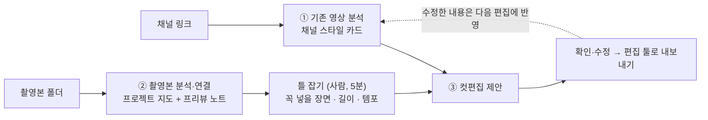
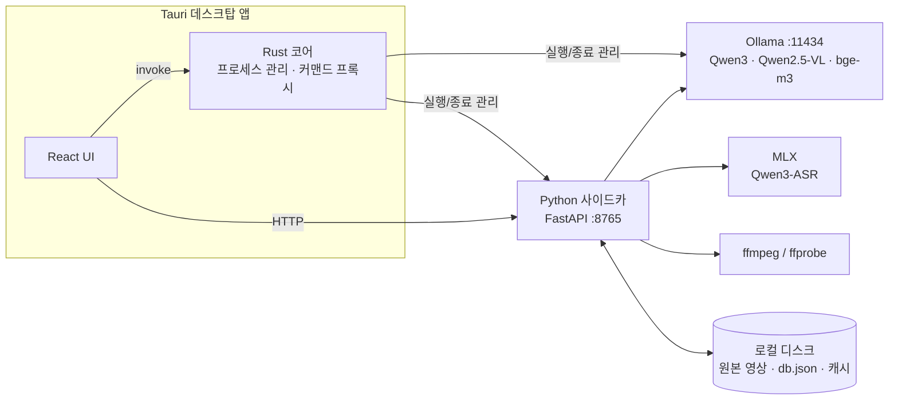
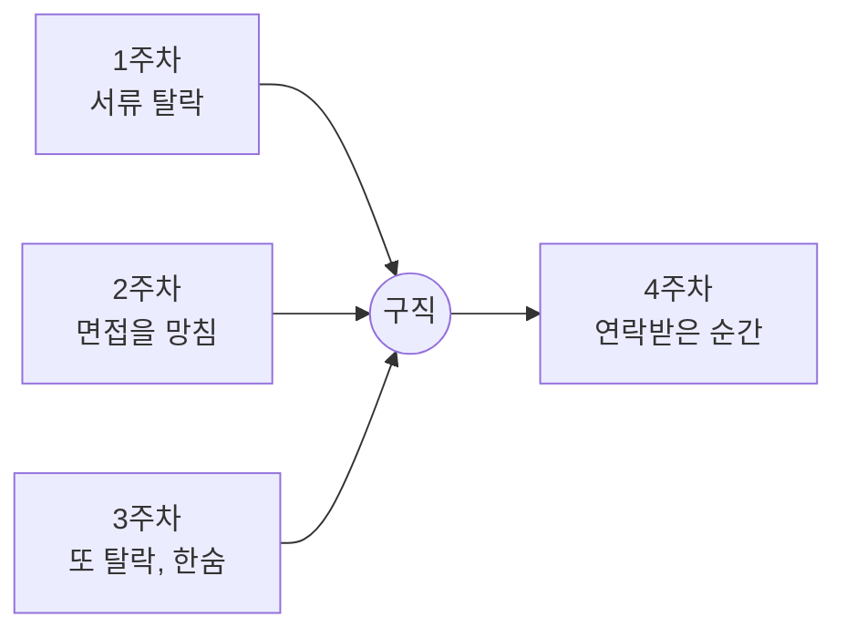

<div align="center">


# 클립팟 (Clippot)

**촬영본을 이해하고 장면 사이의 맥락을 이어, 우리 채널 스타일로 1차 컷편집까지 해주는 AI**

다큐멘터리 프리뷰 노트 자동화 앱 **Preview AI**에서 출발해, 촬영본이 많은 유튜브 채널을 위한 편집 AI로 확장하고 있습니다.<br/>
이 문서는 아이디어, MVP 설계, 그리고 그 밑에 있는 기술 배경과 열린 과제를 한곳에 정리합니다.


**[⬇️ 현재 버전(Preview AI) macOS 앱 다운로드 (.dmg)](https://drive.google.com/file/d/1X8qLTUSMHWGVoJY9d7FbEExsCRnBe4S7/view?usp=sharing)**

</div>

---

## 목차

1. [배경: 어디서 출발했나](#1-배경-어디서-출발했나)
2. [문제 정의](#2-문제-정의)
3. [비전과 MVP](#3-비전과-mvp)
4. [기술 배경](#4-기술-배경)
5. [열린 기술 과제와 교수님 피드백](#5-열린-기술-과제와-교수님-피드백)
6. [검증 계획](#6-검증-계획)
7. [다음 단계](#7-다음-단계)
- [부록 A. 실행 방법 (현재 앱)](#부록-a-실행-방법-현재-앱)
- [부록 B. 분석 필드 기준 요약](#부록-b-분석-필드-기준-요약)
- [부록 C. 기술 스택과 권장 사양](#부록-c-기술-스택과-권장-사양)

---

## 1. 배경: 어디서 출발했나

| 단계 | 대상 | 결과 | 배운 것 |
|---|---|---|---|
| ① 프리뷰 노트 자동화 | 다큐멘터리 팀 | 앱은 동작했지만 반응이 미미 | 고객과 충분히 대화하지 않고 솔루션부터 만들었다 |
| ② 방송국 검토 | 방송국 제작팀 | 진입 전 보류 | 접근 장벽이 높고, 결정권자와 실사용자가 다르고, 검증 주기가 길다. 대신 **실무자 인터뷰에서 핵심 문제(AI에 대한 불신)를 발견** |
| ③ 유튜브 | 촬영본이 많은 채널 (여행·브이로그·예능형) | 검토 중 | 접근이 쉽고, 결정이 빠르고, 피드백을 바로 받을 수 있다 |

출발점은 직접 겪은 일입니다. 다큐멘터리를 만들며 16TB 하드에 쌓인 약 2만 개의 촬영본을 프리뷰 노트로 정리하고 편집까지 이어가는 과정이 너무 험난했습니다.
대상은 바뀌었지만 **촬영 이후 단계의 불편함을 해결한다**는 문제는 그대로입니다.

---

## 2. 문제 정의

### 2.1 촬영 이후의 노동

촬영이 끝나면 원본을 다시 보며 장면을 찾고, 기록하고, 고르고, 자르고, 이어 붙이는 일이 시작됩니다.
원본은 완성본 분량의 수십~수백 배이고, 이 일의 대부분은 판단보다 **확인과 기록**에 가깝습니다.

### 2.2 AI는 장면은 보지만, 맥락은 모른다

방송국 실무자 인터뷰에서 AI 프리뷰를 쓰지 않는 이유는 기능 부족이 아니라 **신뢰**였습니다.

> “사람만이 알 수 있는 것들이 있다.” — 방송국 실무자 인터뷰 중

- **웃음 포인트:** 무엇이 웃긴지는 화면이 아니라 앞뒤 흐름, 타이밍, 관계에서 나온다.
- **장면의 의미:** 같은 표정도 앞의 이야기에 따라 의미가 완전히 달라진다.
- **결국 다시 본다:** 놓친 게 있을까 봐 사람이 원본을 처음부터 다시 본다.

우리도 같은 실패를 겪었습니다.

| AI가 본 것 | 사람이 본 것 |
|---|---|
| 미용실, 바리깡, 머리카락, 웃는 남자들 | 입대 전, 친구들과 장난치며 하는 삭발 |
| → “두피 상태와 탈모 여부를 평가하는 영상” | → 일종의 이별 의식 |

AI는 **무엇이 보이는지**는 말하지만, **그게 무슨 의미인지**는 놓칩니다.

### 2.3 화면과 소리만으로는 알 수 없는 것

| 종류 | 예시 | 풀 수 있는 방향 |
|---|---|---|
| 앞뒤 이야기 | 몇 주 구직에 실패하다 연락받은 순간의 표정 | 프로젝트 전체를 이어서 기억 ([4.4](#44-제안-구조-촬영본-그래프)) |
| 관계·문화 | 입대 전 삭발, 친구끼리의 장난 | 채널의 지난 영상에서 배우기 + 사람의 라벨 |
| 화면 밖 정보 | 오늘이 이 멤버와의 마지막 촬영이라는 것 | 사람만 줄 수 있음 → MVP의 ‘틀 잡기’ ([3.3](#33-mvp-3단계)) |

---

## 3. 비전과 MVP

### 3.1 장기 비전

촬영 직후부터 함께하는 유튜브 에이전트. 촬영본 관리, 편집, 분석·기획, 광고, 수익화까지 다섯 가지 일을 **하나의 채널 기억** 위에서 이어서 하는 것이 최종 그림입니다.
분석 도구는 이미 많지만, 촬영본부터 함께해서 촬영본과 성과를 잇는 곳은 없습니다. 다만 지금 집중하는 것은 그 기반인 **촬영본 이해와 1차 컷편집**입니다.

### 3.2 MVP 원칙

> **AI가 먼저 깔고, 사람은 최소한의 틀만 잡는다.**

AI가 모든 것을 ‘딸깍’ 만들면 결과물이 나빠집니다. 화면 밖 정보처럼 사람만 아는 것이 있기 때문입니다.
그래서 사람이 개입하는 지점을 한 군데(틀 잡기, 5분 이내)로 정하고, 그 외에는 AI가 먼저 채워둡니다.

### 3.3 MVP 3단계



| 단계 | 하는 일 | 결과 | 미정 |
|---|---|---|---|
| ① 기존 영상 분석 | 채널의 최근 영상 10~20편에서 컷 길이, 구성(도입·전개·하이라이트·마무리), 자막, 음악·분위기, 템포를 분석 | 채널 스타일 카드 | 링크만으로 가져와 분석해도 되는지 |
| ② 촬영본 업로드와 분석 | 프리뷰 AI 흐름(복사 없이 경로로 분석) + **장면 잇기** + **한눈에 보기** | 프로젝트 지도 + 프리뷰 노트(‘연결’ 열 추가) | 연결의 정확도, 인물 식별 |
| ③ 컷편집 제안 | 채널 스타일 + 촬영본 지도 + 사람이 잡은 틀로 러프컷을 깔아줌 | 러프컷, 편집 툴로 내보내기 | 틀에 무엇을 넣을지, 라벨링 기준 |

**틀 잡기 후보**

- ★ 꼭 넣을 장면: AI가 기준에 따라 먼저 표시하고, 사람은 넣고 빼기만 한다.
- 길이, 템포
- 그 밖의 틀은 고민 중. 라벨링 기준은 세 군데에서 올 수 있다: AI의 기본 기준(웃음, 리액션, 큰 움직임, 감정이 실린 말), 채널에서 배운 기준(지난 영상에서 실제로 쓰인 장면의 특징), 사람이 준 기준(고친 라벨, 한 줄 의도).

**기획안이 없을 때의 대안**

1. 크리에이터에게 한 줄 의도를 묻는다 (“이번 영상, 한 줄로 뭐예요?”)
2. 촬영본 자체에서 사건·리액션·대사의 흐름으로 이야기를 찾는다
3. 지난 영상에서 구성과 스타일을 배운다

---

## 4. 기술 배경

### 4.1 지금 구현된 것: Preview AI

UI와 분석 로직을 **프로세스 단위로 분리**했습니다. 모든 모델은 Mac에서 로컬로 실행되고, 원본은 외부로 나가지 않으며 복사하지도 않습니다.



**클립 한 개가 분석되는 과정** (`python-sidecar/analyzer.py`)

| 단계 | 모듈 | 내용 |
|---|---|---|
| 1. 전처리 | `preprocess.py` | ffprobe로 길이·촬영 날짜·카메라, 16kHz wav 추출. 저해상도 1fps 필름스트립을 한 번만 디코드해 장면 전환 검출과 미리보기에 재사용 |
| 2. 말소리 검출 | `vad.py` | Silero VAD로 말소리 구간만 골라냄 |
| 3. 음성 인식 | `stt.py` | 말소리 구간만 Qwen3-ASR(MLX)로 인식, 한자 혼입·반복 환각 필터 |
| 4. 장면 설명 | `vlm.py` | 장면 전환 지점의 키프레임(1~8장)만 Qwen2.5-VL로 설명 |
| 5. 종합 판단 | `llm.py` | 자막 + 시각이 붙은 장면 설명 + 기획안 맥락을 Qwen3가 종합 → 요약·키워드·인물·장소 |
| 6. 추천도 | `embed.py` · `scoring.py` | `0.7 × 연관성(bge-m3 코사인) + 0.3 × 품질(초점 + 오디오)` |

결과는 프리뷰 노트 표(썸네일 · 파일명 · 길이 · 날짜 · 장소 · 카메라 · 등장인물 · 한줄요약 · 추천도)와 상세 페이지(자막, 장면 타임라인, 재생)로 보여줍니다.

### 4.2 시행착오와 해결

| # | 문제 | 해결 |
|---|---|---|
| 1 | 바람·엔진·음악 소음이 음성 인식에 들어가 중국어 혼입, 같은 문장 반복 같은 환각 발생 | 입력에서 말소리 구간만 인식(Silero VAD), 출력에서 한자·반복·중복 필터 |
| 2 | 썸네일·장면 검출·키프레임 때문에 영상을 3번 디코드 | 1fps 필름스트립 한 번으로 재사용, 키프레임은 필요한 시각만 시크 (3회 → 1회) |
| 3 | 매 초 장면 설명은 너무 비싸고 느림 | 장면이 바뀌는 지점만 설명, 클립당 1~8회로 제한 |
| 4 | LLM이 장면 타임스탬프를 지어냄 | 장면 목록은 실제 키프레임 시각으로 구성, LLM은 요약만 |
| 5 | 무관한 클립도 추천도 65~80점 | 실제 유사도 범위(0.30~0.85)를 0~100으로 다시 매핑, 기획안이 바뀌면 점수만 재계산 |
| 6 | 여러 클립 동시 분석 시 GPU 경합 | 음성 인식 추론은 직렬화하고 CPU 전처리와 겹치게, 동시성은 RAM 기준 자동 |
| 7 | **글로 바꿔서 판단하는 구조** 때문에 표정·말투·타이밍·웃음이 빠짐 (미용실 사례) | **1초에 1장 이미지 + 음성을 하나의 AI가 동시에 판단**하도록 변경. 조금 더 정확해졌지만 비용이 크게 늘어남 |

> 작성 필요: 7번 방식에 쓴 모델, 입력 구성, 영상 1시간당 비용, 코드 위치. 현재 저장소 코드에는 반영되어 있지 않습니다.

### 4.3 남은 한계

1. **비용:** 화면과 소리를 함께 보는 방식은 정확하지만 비싸다. 촬영본이 수십 시간이면 감당하기 어렵다.
2. **관찰 층은 일부러 ‘보이는 것만’ 기록한다:** 장면 설명은 환각을 막기 위해 감정·의도·전후 맥락을 추측하지 않도록 설계했다([부록 B](#부록-b-분석-필드-기준-요약)). 그래서 맥락 해석은 관찰 층이 아니라 **그 위의 다른 층**에서 해야 한다.
3. **클립 단위 분석:** 지금은 클립마다 따로 분석한다. 같은 사람, 같은 순간(멀티캠), 떡밥과 회수처럼 **클립 사이의 관계**는 어디에도 기록되지 않는다.
4. **화면 밖 정보:** 어떤 모델을 써도 화면과 소리에 없는 정보는 알 수 없다.

### 4.4 제안 구조: 촬영본 그래프

**아이디어:** 옵시디언은 메모를 [[링크]]로 잇고, 많은 메모가 가리키는 메모를 중요하게 보며, 어떤 문장에서 언급됐는지(백링크)를 함께 보여준다. 이 구조를 촬영본에 적용해 **장면을 노트로, 관계를 링크로** 잇는다.



4주차 장면만 따로 보면 ‘웃는 얼굴’이지만, 앞의 장면과 이어서 보면 **3주간의 실패 끝에 온 첫 합격 소식**, 즉 프로젝트에서 가장 중요한 장면이 됩니다.

**설계 원칙**

1. **원자는 구간:** 파일이 아니라 장면(예: 12:30–12:48) 단위로 노트를 만든다.
2. **AI가 쓰고, 사람은 고친다:** 정리 노동은 없고, 수정과 메모만 사람이 한다.
3. **노드 · 속성 · 링크를 구분한다:** 이름 붙일 수 있는 것만 노드, 숫자·날짜는 속성, 관계는 종류가 있는 링크.
4. **모든 링크에 시간과 근거를 단다:** 언제, 어느 클립 몇 초에서, 무엇을 보고 연결했는지.
5. **평범한 파일로 저장한다:** 원본은 로컬에 두고, 지도(텍스트)만 가볍게. 실험 단계에서는 실제 옵시디언으로 열어볼 수 있다.

**노드와 링크**

| 노드 | 예시 | 주요 속성 |
|---|---|---|
| 촬영 세션 | 10/03 제주 2일차 | 날짜, 장소 |
| 클립 | A캠_0923.mp4 | 원본 경로, 카메라, 길이, 초점·음량 |
| 구간 | 12:30–12:48 | 대사, 장면 설명, 에너지, 사용 여부 |
| 인물·장소·상황 | 민수, 귤밭, 넘어짐 | 별칭, 첫 등장, 사람이 쓴 메모 |
| 결과물 | 러프컷 v3, 5화 | 버전, 업로드일, 성과 |
| 스타일 규칙 | 리액션 컷 +0.5초 | 근거가 된 수정 기록 |

| 링크 | 방향 | 어디서 생기나 |
|---|---|---|
| 포함 | 세션 → 클립 → 구간 | 폴더·파일 메타데이터 |
| 등장 | 구간 → 인물·장소·상황 | 음성 인식, 장면 설명, 얼굴·목소리 묶기 |
| 같은 순간 | 구간 ↔ 구간 | 소리 동기화로 찾은 멀티캠 |
| 이어지는 이야기 | 구간 → 구간 | 시간 순서, 떡밥(“내일 한라산 가자”) → 회수 |
| 비슷함 | 구간 ↔ 구간 | 임베딩 유사도 |
| 사용됨 | 구간 → 결과물 | 편집 채택 (편집 툴 프로젝트 파일 또는 원본 대조) |

**지금 분석 필드에서 바로 옮길 수 있는 것**

| 현재 필드 | 그래프에서 |
|---|---|
| `filename`, `filepath`, `camera`, `duration_sec` | 클립 노드와 속성 |
| `date` | 촬영 세션 링크 |
| `people`, `place`, `keywords` | 인물·장소·상황 링크 |
| `scenes`(키프레임 시각 + 설명), `transcript_segments` | 구간 노드 |
| bge-m3 임베딩 | ‘비슷함’ 링크 후보 |

> 빈칸: 지금 `people`은 대사와 장면 설명을 보고 LLM이 추정한 값이라, 클립이 바뀌면 같은 사람인지 보장하지 못한다. 얼굴·목소리 임베딩으로 같은 사람을 묶고 사람이 처음 한 번 이름을 붙이는 단계가 필요하다.

**중요도와 ‘뻔한 허브’ 문제**

옵시디언처럼 “많이 연결된 노트가 중요하다”를 그대로 쓰면, 1인 채널에서는 모든 장면에 나오는 크리에이터 본인이 가장 중요해진다. 뻔한 정보다. 그래프 이론의 도구로 보완한다.

| 방법 | 쉽게 말하면 | 촬영본에서 |
|---|---|---|
| 허브 낮추기 (IDF) | 어디에나 있는 것은 덜 중요하게 | 모든 장면에 나오는 ‘나’는 배경으로 |
| Adamic-Adar | 드문 이웃을 공유할수록 강한 연결 | 민수와 귤밭이 ‘넘어짐’이라는 드문 상황을 공유 |
| 매개 중심성 | 무리와 무리를 잇는 노드 | 이야기의 전환점 후보 |
| 커뮤니티 탐지 | 촘촘하게 엉킨 무리 | 시퀀스·챕터 후보 |
| Personalized PageRank | 질문에서 출발해 퍼지는 중요도 | “민수 특집” 요청이면 민수 기준으로 다시 계산 |
| 편집 채택 | 사람이 실제로 고른 것 | 원본 중 최종본에 쓴 구간 |

반응(시청 지속 등)이 그 연결 때문인지는 **증명할 수 없다.** 그래서 신호마다 믿을 만한 정도를 나눠 쓰고, 단정 대신 ‘가설 + 근거 + 확신도’로 보여준다. 가장 깨끗한 신호는 **편집 채택**(측정 오차가 없고, 촬영본부터 함께해야만 얻을 수 있음)이고, 그다음이 타임스탬프 댓글과 되감기 구간이다.

**그래프 뷰**

보여야 고칠 수 있고, 고칠 수 있어야 믿을 수 있다. 옵시디언 그래프 뷰의 기능을 그대로 쓸 수 있다.

| 그래프 기능 | 촬영본에서 |
|---|---|
| 필터 | “민수 + 웃음 + 미방분”만 보기 |
| 로컬 그래프 깊이 | 1 = 이 구간의 인물·장소, 2 = 같은 인물의 다른 구간, 3 = 그 구간이 쓰인 영상 |
| 방향 | 들어오는 링크(민수가 나온 구간) / 나가는 링크(이 구간에 나온 것) |
| 그룹 색 | 촬영일, 카메라, 미방분 여부 |
| 아직 없는 노트(유령 노드) | 기획안에는 있는데 촬영본에 없는 장면 = **빠진 샷** |

노드가 수천 개가 되면 전체 그래프는 의미가 흐려지므로, 기본 화면은 로컬 그래프와 필터가 되어야 한다.

### 4.5 자동 편집까지의 기술 단계

| 단계 | 하는 일 | 현재 |
|---|---|---|
| ① 쪼개기 | 클립을 장면·발화 단위로 나눔 | 있음 (장면 전환 검출, 말소리 검출) |
| ② 설명하기 | 장면마다 대사·화면·소리를 기록 | 있음 (음성 인식, 장면 설명, 멀티모달 판단 실험) |
| ③ 잇기 | 같은 사람·같은 순간·같은 멘트(테이크)·떡밥과 회수 | **없음 ← 핵심 과제** |
| ④ 고르기 | 의도(한 줄, 채널 스타일, 틀)에 맞는 장면 선택 | 일부 (기획안 연관 추천도) |
| ⑤ 배열하기 | 이야기 순서와 템포 | 없음 |
| ⑥ 내보내기 | 프리미어·파이널컷 타임라인 | 없음 |
| ⑦ 배우기 | 사용자의 수정에서 취향 학습 | 없음 |

### 4.6 관련 연구와 도구

**연구**

| 이름 | 핵심 | 우리에게 |
|---|---|---|
| [VideoRAG](https://arxiv.org/abs/2502.01549) (2025) | 여러 영상에 걸친 지식 그래프 + 프레임 특징 | 촬영본 여러 개를 하나의 그래프로 묶는 선례 |
| [GraphVideoAgent](https://arxiv.org/abs/2501.15953) (ACM MM 2025) | 인물·사물 관계 그래프, 사라졌다 다시 나오는 인물의 동일성 문제 지적 | 클립 사이 인물 식별 |
| [M3-Agent](https://arxiv.org/abs/2508.09736) (ICLR 2026) | 영상·소리로 사건 기억과 의미 기억을 따로 쌓음, 인물 중심 | 구간(사건)과 인물·상황(의미)의 분리 |
| [MovieGraphs](https://arxiv.org/abs/1712.06761) (CVPR 2018) | 영화 클립의 인물·관계·상호작용·이유를 그래프로 주석 | ‘상황’ 노드 설계 참고 |
| [A-MEM](https://arxiv.org/abs/2502.12110) (NeurIPS 2025) | 제텔카스텐식 AI 기억, 새 기억이 옛 노트를 갱신 | 쌓이며 자라는 스타일 노트 |
| [HippoRAG](https://arxiv.org/abs/2405.14831) (NeurIPS 2024) | 개념 그래프 + Personalized PageRank로 검색 | 질문 기반 중요도 |
| [GraphRAG](https://www.mintlify.com/microsoft/graphrag/concepts/community-detection) (Microsoft) | 그래프를 커뮤니티로 나누고 요약 | 시퀀스 자동 묶음과 요약 |
| [LAVE](https://www.dgp.toronto.edu/~bryanw/lave/) (IUI 2024) | 클립 설명 + 자연어 명령으로 편집하는 에이전트, 개인화는 향후 과제 | 취향 학습은 아직 빈자리 |
| [EditDuet](https://arxiv.org/abs/2509.10761) (2025) | 편집자 에이전트와 비평가 에이전트가 타임라인에서 협업 | 편집 + 검수 구조 |

**도구**

| 도구 | 하는 일 | 촬영본 이해 | 채널 맥락 |
|---|---|---|---|
| 유튜브 스튜디오 | 성과 분석, 썸네일·제목 A/B 테스트 | — | 숫자만 |
| Vrew · CapCut | 자막·컷편집 자동화 | 말 위주 | — |
| Descript | 녹취 기반 편집 + AI 공동 편집자 | 일부 | — |
| invideo AI | 프롬프트로 영상 생성, 명령으로 장면 단위 편집 | 생성 위주 | 프로젝트 기획만 |
| Opus Clip | 롱폼에서 숏츠 추출 | 일부 | — |
| Premiere 미디어 인텔리전스 · Jumper | 촬영본 장면 검색 (Premiere 시각 검색은 영어만) | 있음 | — |

장면 검색과 대화형 편집은 이미 시장에 있다. 클립팟이 노리는 자리는 **클립 사이의 맥락을 잇는 것, 채널의 기억이 쌓이는 것, 한국어 비대본 촬영본**의 조합이다.

---

## 5. 열린 기술 과제와 교수님 피드백

### 5.1 열린 과제

| 과제 | 왜 어려운가 |
|---|---|
| 클립 사이 인물 재식별 | 브이로그 촬영본은 조명·각도·거리가 제각각이다 |
| 멀티캠·테이크 묶기 | 같은 순간, 같은 멘트를 여러 번 찍은 것을 찾아 묶어야 한다 |
| 비용 효율적인 멀티모달 이해 | 화면 + 소리를 함께 보면 정확하지만 비싸다. 가벼운 신호로 후보를 먼저 거르는 2단계 방식 등 검토 필요 |
| 의도에 맞춘 장면 선택 | “민수 리액션 위주로” 같은 요청을 장면 선택으로 옮기는 일 |
| 러프컷 품질 평가 | 정답이 없는 문제라 평가 기준부터 정해야 한다 |
| 사용자 수정에서 배우기 | 고친 내용을 규칙으로 일반화하는 방법 |
| 업로드 영상 ↔ 원본 대조 | 완성본의 각 지점이 어느 원본 구간이었는지 역추적 (자막·효과·속도 조절이 들어가면 어려워짐) |

### 5.2 교수님 미팅 (2026.11, 김동근 교수님)

> 작성 필요: 미팅에서 들은 내용을 아래 형식으로 기록한다.

| 주제 | 들은 것 | 우리의 해석 | 다음 행동 |
|---|---|---|---|
| 맥락 이해 / 비용 | | | |
| 촬영본 그래프 구조 | | | |
| MVP와 사람이 잡는 틀 | | | |
| 진로·랩실 | | | |

---

## 6. 검증 계획

만들기 전에 묻는다. 지난번 실패의 원인이 고객과의 대화 부족이었기 때문이다.

| # | 가설 | 인터뷰에서 확인 | 체험판·개발로 확인 |
|---|---|---|---|
| 1 | 촬영본이 많은 채널은 원본 확인에 시간을 가장 많이 쓴다 | 마지막 영상에서 원본 보는 데 몇 시간 걸렸나 | 지도를 받은 뒤 편집 시간이 줄었나 |
| 2 | 촬영본끼리 묶어 보여주면 편집이 쉬워진다 | 원본을 어떻게 정리하나 | 자동 묶음이 그 사람의 묶는 방식과 비슷한가 |
| 3 | 기획안이 없어도 한 줄 의도 + 촬영본이면 쓸 만한 러프컷이 나온다 | 기획안을 쓰는지, 편집자에게 뭘 전달하는지 | 러프컷을 처음부터 다시 하지 않고 고쳐서 쓰나 |
| 4 | 크리에이터마다 편집 취향이 뚜렷하고 반복된다 | 자주 하는 수정 요청은 무엇인가 | 2회차부터 수정 요청이 줄어드나 |
| 5 | 결과가 좋으면 촬영본을 계속 맡긴다 | 지금 외주비나 툴에 얼마 쓰나 | 체험 후 두 번째 촬영본을 맡기나 |

**방법**

- **인터뷰 20명:** “이 기능 쓸래요?” 대신 “마지막 영상 한 편을 촬영부터 업로드까지 말해줄래요?”를 묻는다. 기능 설명은 맨 마지막에만 한다.
- **기능 카드 고르기:** 촬영본 지도, 자동 러프컷, 대화형 수정, 모자이크, 숏츠 추출, 성과 분석, 협찬 관리 등을 카드로 만들어 필요한 순서대로 놓게 한다.
- **체험판:** 인터뷰 후 촬영본 1회분(1~3시간)을 받아 48시간 안에 촬영본 지도, 러프컷 또는 구성안, 수정 1회를 돌려준다. 기술이 안 되는 부분은 사람이 채운다(오즈의 마법사 방식). 손으로 한 일 중 반복되는 것부터 자동화한다.

---

## 7. 다음 단계

> 기술 논의 후 확정한다.

지금 바로 해볼 수 있는 실험 후보:

1. **촬영본 그래프 v0:** 현재 분석 결과(`db.json`)를 옵시디언 호환 폴더(구간별 마크다운 + 속성 + 링크)로 내보내, 실제 촬영본 3~5회 분량으로 그래프를 눈으로 확인한다.
   - 판단 기준: 자동 묶음이 편집자의 묶음과 비슷한가, 잊었던 장면을 하나라도 발견했나, ‘나’를 숨겨도 구조가 남는가
2. **에이전트 붙이기:** 그 폴더에 AI 에이전트를 붙여 “민수 웃는 장면 찾아줘”, “귤밭 시퀀스 구성안 짜줘”, “빠진 샷 알려줘”를 시험한다.
3. **인물 묶기:** 얼굴·목소리 임베딩으로 클립 사이 같은 사람을 묶는 최소 실험.

---

## 부록 A. 실행 방법 (현재 앱)

### 사전 준비

```bash
# 1) 시스템 도구 (Ollama 데몬은 앱이 자동 실행)
brew install ffmpeg ollama

# 2) Python 환경 — conda 환경 이름은 'preview' 권장 (앱이 자동 탐색)
conda create -n preview python=3.11 -y
conda activate preview
cd python-sidecar && pip install -r requirements.txt
```

로컬 모델(`qwen3:8b` · `qwen2.5vl:3b` · `bge-m3` · Qwen3-ASR)은 앱 첫 실행 셋업 화면이 없는 것만 자동으로 받습니다.
미리 받고 싶다면 `ollama pull qwen3:8b qwen2.5vl:3b bge-m3`.

### 개발 실행

```bash
npm install
npm run tauri:dev     # Ollama · Python 사이드카 · UI가 모두 자동 실행됨
npm run dev           # UI만 목 데이터로 미리보기 → http://localhost:1420 (우상단 "데모 모드")
```

- 이전 dev 세션이 남긴 사이드카(8765)는 자동 정리됩니다. 수동 정리: `lsof -ti:8765 | xargs kill -9`
- conda 환경이 표준 위치가 아니면: `PREVIEW_PYTHON=/path/to/python npm run tauri:dev`

### 설정 (`models.config`)

모델 · 추천도 가중치 · 임계값을 프로젝트 루트의 `models.config`(TOML)에서 바꿉니다. 수정 후 앱을 재시작하면 적용됩니다.
우선순위는 **환경변수 > `models.config` > RAM 자동 선택**입니다.

```toml
[models]
llm   = "qwen3:8b"        # ""로 비우면 RAM에 맞춰 자동 선택
vlm   = "qwen2.5vl:3b"
embed = "bge-m3"
asr   = "mlx-community/Qwen3-ASR-1.7B-4bit"

[scoring]
weight_relevance = 0.7
weight_quality   = 0.3
threshold_green  = 80
threshold_yellow = 50

[preprocess]
scene_detect     = true
scene_threshold  = 0.5
keyframe_min     = 1
keyframe_max     = 8
vad_threshold        = 0.5
vad_min_total_speech = 0.6
scrub_interval       = 1.0

[runtime]
concurrency = 2           # 0이면 RAM 기준 자동
```

<details>
<summary><b>분석이 느릴 때</b></summary>

- 더 작은 ASR 모델(`mlx-community/Qwen3-ASR-0.6B-4bit`)로 바꾸면 클립당 속도가 크게 빨라집니다.
- 16GB 기본 동시성(1)은 전처리와 추론이 겹치지 않으니 `concurrency = 2`로 올리면 효과가 큽니다. 4 이상은 모델 재로드로 오히려 느려질 수 있습니다.
- 모델 다운로드가 0%에서 멈추면 기본 다운로더를 쓰세요. 빠른 다운로더는 `PREVIEW_FAST_DOWNLOAD=1`로 명시적으로 켭니다.

</details>

### 배포 빌드

```bash
bash scripts/prepare-binaries.sh   # ollama·ffmpeg 복사 + 사이드카 PyInstaller
npm run tauri:build                # .app / .dmg
```

<details>
<summary><b>설치 시 “손상되었기 때문에 열 수 없습니다”</b></summary>

서명·공증이 없는 앱을 Gatekeeper가 막는 것입니다.

- **팀 내부 테스트:** 설치 후 한 번 `xattr -cr "/Applications/Preview AI.app"`
- **정식 배포:** Apple Developer ID 서명 + 공증. `tauri.conf.json`의 `bundle.macOS.signingIdentity`를 설정하고 `APPLE_ID` · `APPLE_PASSWORD` · `APPLE_TEAM_ID` 환경변수로 공증을 켭니다.

</details>

---

## 부록 B. 분석 필드 기준 요약

클립마다 생성하는 AI 분석 필드의 작성 기준입니다. 프롬프트(`python-sidecar/llm.py`, `vlm.py`)는 이 기준을 그대로 구현합니다.

| 필드 | 역할 | 기준 |
|---|---|---|
| 한줄요약 (`one_line`) | 표에서 5초 안에 “열어볼지” 판단 | 한 문장 |
| 영상요약 (`summary`) | 재생하지 않고 클립 전체 파악 | **3문장 고정**: 핵심(누가·어디서·무엇) → 전개(시간 흐름) → 특이점(편집 판단에 영향을 주는 것). 특이점이 없으면 2문장. 자막·장면 설명에서 추적 가능한 사실만 |
| 핵심키워드 (`keywords`) | 스캔용 태그 + 추천도 계산의 입력 | **5~8개**, 인물·피사체 / 장소·공간 / 행위·사건 / 소재·주제 4개 파셋을 고루. “사람”, “일상” 같은 범용어 금지. 기획안 키워드는 표기를 통일하되, 관측되지 않은 기획안 키워드를 끼워 넣지 않음 |
| 영상내용 (`scenes[].desc`) | 클립 안에서 순간 찾기, 모든 필드의 근거층 | 장면당 1~2문장, 피사체 → 행동 → 장소 → 구도 순. **보이는 것만 기록**하고 감정·의도·전후 맥락은 추측하지 않음. 화면 속 글자는 기록 |

영상내용이 ‘보이는 것만’ 기록하도록 정한 것은 환각이 모든 하위 필드로 전파되는 것을 막기 위해서입니다. 맥락 해석은 이 층이 아니라 촬영본 그래프([4.4](#44-제안-구조-촬영본-그래프))에서 다룹니다.

---

## 부록 C. 기술 스택과 권장 사양

| 분류 | 기술 |
|---|---|
| Desktop | Tauri 1.5 (Rust) |
| Frontend | React 18 · TypeScript · Vite · Zustand |
| Backend (Sidecar) | Python 3.11 · FastAPI · PyInstaller |
| 영상/오디오 | ffmpeg · ffprobe · OpenCV |
| STT | Qwen3-ASR 1.7B 4bit (MLX) · Silero VAD (ONNX) |
| VLM / LLM | Qwen2.5-VL 3B/7B · Qwen3 8B/14B/30B (Ollama) |
| 임베딩 | bge-m3 (Ollama) |
| 문서 파싱 | PyMuPDF |

| 항목 | 최소 | 권장 |
|---|---|---|
| OS | macOS, Apple Silicon (MLX 전용) | 최신 macOS |
| 메모리 | 16GB (`qwen3:8b` / `qwen2.5vl:3b`) | 24~32GB (`qwen3:14b` / `qwen2.5vl:7b`), 48GB+ (`qwen3:30b`) |
| 네트워크 | 첫 실행 시 1회 모델 다운로드 | 이후 완전 오프라인 |
