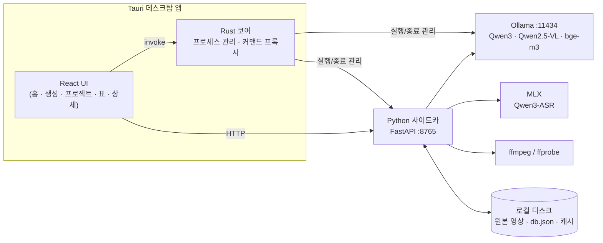
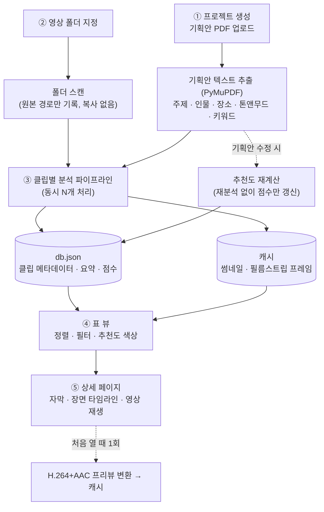
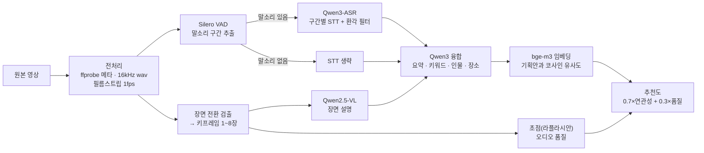

<div align="center">


# Preview AI

**다큐멘터리 촬영 원본을 로컬 AI로 분석해 프리뷰 노트를 자동으로 만드는 데스크탑 앱**

영상 폴더 하나만 지정하면 자막 · 장면 설명 · 키워드 · 기획 의도 대비 추천도를 뽑아 표로 정리합니다.<br/>
모든 모델은 내 Mac에서 실행되며, **영상은 한 프레임도 외부로 나가지 않습니다.**


**[⬇️ macOS 앱 다운로드 (.dmg)](https://drive.google.com/file/d/1X8qLTUSMHWGVoJY9d7FbEExsCRnBe4S7/view?usp=sharing)**

</div>

---

## 목차

- [프로젝트 소개](#프로젝트-소개)
- [주요 기능](#주요-기능)
- [시스템 아키텍처](#시스템-아키텍처)
- [데이터 플로우](#데이터-플로우)
- [분석 파이프라인 상세](#분석-파이프라인-상세)
- [기술적 고민과 해결](#기술적-고민과-해결)
- [기술 스택](#기술-스택)
- [권장 사양](#권장-사양)
- [실행 방법](#실행-방법)
- [설정 (`models.config`)](#설정-modelsconfig)
- [배포 빌드](#배포-빌드)
- [로드맵](#로드맵)

---

## 프로젝트 소개

### 프리뷰 노트란?

다큐멘터리는 대본을 먼저 쓰고 찍는 드라마와 달리, **일단 현장을 찍고 나서 그 안에서 이야기를 찾아 편집**합니다.
그래서 촬영이 끝나면 편집 전에 반드시 거치는 단계가 **프리뷰(preview)** — 촬영 원본을 처음부터 끝까지
돌려 보며 내용을 기록하는 작업입니다. 이때 만드는 기록이 **프리뷰 노트**입니다.

<sub>프리뷰 노트 예시</sub>

| 파일명 | 타임코드 | 내용 (대사 · 장면) | 인물 · 장소 | 비고 |
|---|---|---|---|---|
| A001_C003.mov | 00:02:14 | 할머니가 텃밭에서 "올해는 비가 안 와서…" | 할머니 / 텃밭 | 인터뷰 핵심, 오디오 양호 |
| A001_C004.mov | 00:00:00 | 마을 전경 드론 숏, 해 질 녘 | — / 마을 | 오프닝 후보, 초점 OK |

프리뷰 노트는 편집의 **검색 인덱스이자 설계도**입니다. PD와 편집자는 이 노트를 보고
"어떤 컷이 있는지", "그 말을 언제 했는지", "기획 의도에 맞는 장면이 어디 있는지"를 찾아 구성안을 짭니다.
노트 없이 편집을 시작하면 수백 개 클립을 매번 다시 열어 봐야 합니다.

### 왜 자동화가 필요했나

- **시간** — 원본은 보통 방송 분량의 수십~수백 배입니다. 프리뷰는 실제 재생 시간 이상이 걸리고
  (멈추고, 받아 적고, 되감고), 막내 PD·FD의 시간 대부분이 여기에 들어갑니다.
- **반복 노동** — 대사 받아 적기, 장면 묘사, 파일명·타임코드 정리는 판단보다 **기록**에 가까운 일이라
  사람이 하기엔 비용이 크고 실수도 잦습니다.
- **품질 편차** — 누가 노트를 썼느냐에 따라 상세함과 형식이 달라, 다른 사람이 쓴 노트는 다시 확인해야 합니다.
- **정작 중요한 판단은 뒤로 밀림** — "이 컷이 기획에 맞는가"를 고민해야 할 시간이 받아 적기에 소모됩니다.

Preview AI의 목표는 **기록은 AI가, 판단은 사람이** 하도록 나누는 것입니다.
AI가 자막 · 장면 설명 · 키워드로 1차 노트를 채우고 기획안 기준 추천도를 매겨 두면,
사람은 추천도가 높은 컷부터 확인하며 구성에 집중할 수 있습니다.

### 기존 도구로는 안 됐던 이유

클라우드 AI 서비스로 이 작업을 자동화하기엔 걸림돌이 있었습니다.

- **보안** — 미공개 촬영 원본·인터뷰를 외부 서버에 올릴 수 없음
- **용량** — ProRes·MXF 원본은 클립 하나가 수 GB라 업로드·복사 자체가 부담
- **맥락** — 일반적인 요약이 아니라 "*이 기획안 기준으로* 쓸 만한 컷인가"가 필요함

### 해결

Preview AI는 **완전 로컬**에서 동작하는 멀티모달 분석 파이프라인으로 이 문제를 풉니다.

| 목표 | 접근 |
|---|---|
| 영상이 외부로 나가지 않을 것 | ASR · VLM · LLM · 임베딩 모델을 모두 로컬 실행 (Ollama + MLX) |
| 대용량 원본을 그대로 다룰 것 | 폴더 경로만 받아 **원본을 복사하지 않고** 제자리에서 분석 |
| 기획 의도에 맞는 컷을 찾을 것 | 기획안(PDF)을 함께 넣어 **추천도**(연관성 + 기술 품질) 산출 |
| 설치가 쉬울 것 | 앱 하나만 설치 → 첫 실행 시 필요한 모델만 자동 다운로드 |

---

## 주요 기능

- **폴더 단위 일괄 분석** — 하위 폴더까지 스캔, 이미 분석한 파일은 자동 건너뜀
  (mp4 · mov · mxf · m4v · avi · mts · m2ts · mkv)
- **자막 생성 (STT)** — 말소리 구간만 골라 Qwen3-ASR로 인식, 타임스탬프는 원본 영상 기준
- **장면 설명 (VLM)** — 장면 전환 지점의 키프레임을 Qwen2.5-VL로 설명 → 대사 없는 B롤도 분석
- **클립 요약** — 자막 + 장면 설명 + 기획안 맥락을 LLM이 종합해 한줄요약 · 키워드 · 인물 · 장소 · 코멘트 작성
- **추천도** — 기획안과의 의미적 연관성(70%) + 초점·오디오 품질(30%), 색상(초록/노랑/빨강)으로 표시
- **스프레드시트 뷰** — 썸네일에 마우스를 올리면 자동 재생되는 플립북 미리보기, 스크럽 바로 시간 이동
- **상세 페이지** — 어떤 코덱이든 즉시 재생(온디맨드 H.264 변환), 타임스탬프 클릭 시 해당 지점부터 재생
- **원클릭 실행** — Ollama · Python 서버를 앱이 알아서 띄우고 종료 시 정리

---

## 시스템 아키텍처

UI와 분석 로직을 **프로세스 단위로 분리**했습니다. 분석 워커는 HTTP API만 노출하므로,
추후 웹 서비스로 전환할 때 사이드카를 그대로 재사용할 수 있습니다.



| 레이어 | 위치 | 역할 |
|---|---|---|
| 프론트엔드 | `src/` | React + Zustand. 홈 · 프로젝트 생성 · 프로젝트 홈 · 표 · 상세 화면. Pretendard 폰트 self-host로 오프라인 동작 |
| Rust 코어 | `src-tauri/` | 앱 시작 시 Ollama · 사이드카 자동 실행, 고아 프로세스 정리, 네이티브 폴더 다이얼로그 |
| 분석 워커 | `python-sidecar/` | FastAPI 서버 + 전처리 · VAD · STT · VLM · LLM · 임베딩 · 스코어링 전 단계 |

---

## 데이터 플로우

사용자 관점에서 데이터가 흘러가는 전체 과정입니다.



### 클립 한 개가 분석되는 과정



---

## 분석 파이프라인 상세

오케스트레이션은 `python-sidecar/analyzer.py`가 담당합니다.

| 단계 | 모듈 | 내용 |
|---|---|---|
| 1. 전처리 | `preprocess.py` | ffprobe 1회로 길이 · 촬영 날짜 · 카메라 정보 조회, ffmpeg로 16kHz wav 추출. 영상 디코드는 **저해상도 1fps 필름스트립 1회**뿐이며, 이 프레임으로 장면 전환을 찾고 선택된 시각만 풀해상도로 시크해 키프레임 추출 + 초점 측정 |
| 2. VAD | `vad.py` | Silero VAD(ONNX, 오프라인)로 말소리 구간만 골라냄. RMS 음량은 값싼 1차 필터로만 사용 |
| 3. STT | `stt.py` | 말소리 구간만 잘라 Qwen3-ASR(MLX)로 인식, 타임스탬프를 구간 시작 시각으로 보정. 후처리로 한자 혼입 제거 · 반복 환각 폐기 · 연속 중복 축약 |
| 4. VLM | `vlm.py` | 키프레임마다 Qwen2.5-VL로 장면 설명. 호출 수는 키프레임 수(1~8회)로 제한 |
| 5. 융합 | `llm.py` | 자막 + `[mm:ss]` 시각이 붙은 장면 설명 + 기획안 맥락을 Qwen3가 종합해 JSON 생성. 장면 타임라인은 LLM이 아닌 **실제 키프레임 시각**으로 구성해 정확도 보장 |
| 6. 추천도 | `embed.py` · `scoring.py` | `0.7 × 연관성(bge-m3 코사인) + 0.3 × 기술품질(초점 + 오디오)` · 80%↑ 초록 / 50~79% 노랑 / 49%↓ 빨강 |

---

## 기술적 고민과 해결

### 1. 소음 구간에서 발생하는 ASR 환각
**문제** — 바람 · 엔진 · 음악 같은 비음성 소음이 ASR에 들어가면 중국어가 섞이거나 같은 문장이 무한 반복되는 환각이 발생했습니다.<br/>
**해결** — 2단 방어선을 구성했습니다.
1. **입력 단계**: Silero VAD로 말소리 구간만 잘라 인식. 드론 B롤처럼 대사가 없는 클립은 STT를 아예 건너뜀 → 속도와 품질 동시 개선
2. **출력 단계**: 한자 덩어리 폐기(`_filter_chinese`), 단어 · n-gram 반복 감지(`_is_degenerate`), 연속 중복 축약(`_dedupe_segments`). 필터 후 남는 내용이 없으면 '음성 없음'으로 처리하고 VLM 장면 설명이 그 자리를 채움

### 2. 대용량 원본의 반복 디코딩 비용
**문제** — 초기 구조는 썸네일 · 장면 검출 · 키프레임을 위해 영상을 3번 디코드해, ProRes 원본에서 전처리가 병목이었습니다.<br/>
**해결** — 호버 미리보기용 **1fps 필름스트립을 한 번만 디코드**하고, 그 프레임을 장면 검출(HSV 히스토그램 Bhattacharyya 거리)에 재사용. 키프레임은 선택된 시각만 시크해서 추출 → **디코드 3회 → 1회**.

### 3. 영상 길이에 비례하는 VLM 비용
**문제** — 매 초마다 VLM을 호출하면 긴 클립의 분석 시간이 폭증합니다.<br/>
**해결** — **장면이 바뀌는 지점**의 중앙 프레임만 대표로 사용하고 장면 수를 1~8개로 제한. 장면이 거의 없으면 균등 간격으로 폴백. 클립 길이와 무관하게 VLM 호출 비용이 통제됩니다.

### 4. 변별력 없는 추천도
**문제** — 코사인 유사도를 `(cos+1)/2`로 변환하자 무관한 클립도 65~80점이 나와 추천도가 의미가 없었습니다.<br/>
**해결** — 실제 관측 범위 `[0.30, 0.85]`를 0~100으로 선형 매핑해 점수 분포를 넓힘. 기획안이 바뀌면 재분석 없이 **추천도만 재계산**할 수 있게 분리했습니다.

### 5. GPU 하나를 공유하는 병렬 처리
**문제** — 여러 클립을 동시에 분석하면 MLX 추론끼리 GPU를 두고 경합해 오히려 느려졌습니다.<br/>
**해결** — STT 추론은 락(`_infer_lock`)으로 직렬화하고, 대신 **CPU 전처리(ffmpeg · 장면 검출)가 다른 클립의 GPU 추론과 겹치도록** 클립 단위 동시성을 둠. LLM/VLM은 `keep_alive=30m`으로 모델 재로드를 방지. 동시성은 RAM에 맞춰 자동 결정(16GB→1, 24~32GB→2, 48GB+→3).

### 6. "앱 하나만 설치하면 되는" 배포
**문제** — 사용자가 Python · Ollama · ffmpeg · 모델 수십 GB를 직접 설치하게 할 수는 없었습니다.<br/>
**해결** — Ollama · ffmpeg 바이너리와 PyInstaller로 묶은 사이드카를 앱에 동봉하고, 모델 가중치는 **첫 실행 셋업 화면에서 없는 것만** 진행률과 함께 다운로드. 설치 파일이 가벼워지고 공증도 빨라졌습니다.

---

## 기술 스택

| 분류 | 기술 |
|---|---|
| Desktop | Tauri 1.5 (Rust) |
| Frontend | React 18 · TypeScript · Vite · Zustand · React Router |
| Backend (Sidecar) | Python 3.11 · FastAPI · Uvicorn · PyInstaller |
| 영상/오디오 | ffmpeg · ffprobe · OpenCV(장면 검출 · 초점 측정) |
| STT | Qwen3-ASR 1.7B 4bit (MLX) · Silero VAD (ONNX) |
| VLM / LLM | Qwen2.5-VL 3B/7B · Qwen3 8B/14B/30B (Ollama) |
| 임베딩 | bge-m3 (Ollama) |
| 문서 파싱 | PyMuPDF |

---

## 권장 사양

| 항목 | 최소 | 권장 |
|---|---|---|
| OS | macOS (Apple Silicon, M1 이상) — MLX가 Apple Silicon 전용 | 최신 macOS |
| 메모리 | 16GB (`qwen3:8b` / `qwen2.5vl:3b`) | 24~32GB (`qwen3:14b` / `qwen2.5vl:7b`), 48GB+ (`qwen3:30b`) |
| 네트워크 | 첫 실행 시 1회 모델 다운로드 | 이후 완전 오프라인 동작 |

RAM을 감지해 모델 티어를 자동 선택합니다(16GB→8b/3b, 24~32GB→14b/7b, 48GB+→30b/7b).
개발 환경에는 추가로 Node.js · Rust 툴체인 · conda(Python 3.11)가 필요합니다.

---

## 실행 방법

### 사전 준비

```bash
# 1) 시스템 도구 (Ollama 데몬은 앱이 자동 실행하므로 따로 띄울 필요 없음)
brew install ffmpeg ollama

# 2) Python 환경 — conda 환경 이름은 'preview' 권장 (앱이 자동 탐색)
conda create -n preview python=3.11 -y
conda activate preview
cd python-sidecar && pip install -r requirements.txt
```

> 기존 환경을 쓰고 있다면 VAD 의존성만 추가로: `pip install pysilero-vad` (Silero VAD, ONNX·오프라인)

로컬 모델(`qwen3:8b` · `qwen2.5vl:3b` · `bge-m3` · Qwen3-ASR)은 **미리 받을 필요가 없습니다** —
앱 첫 실행 시 셋업 화면이 없는 것만 자동으로 받습니다(아래 "첫 실행 셋업" 참고).
미리 받고 싶다면 `ollama pull qwen3:8b qwen2.5vl:3b bge-m3`.

### 개발 실행

```bash
npm install

# 데스크탑 앱 — 이 명령 하나로 Ollama·Python 사이드카·UI가 모두 자동 실행됨
npm run tauri:dev
```

`npm run tauri:dev` 는 dev 모드에서 다음을 자동으로 처리한다:

- **Ollama**: 11434에 이미 떠 있으면 재사용, 없으면 시스템 `ollama serve` 자동 실행
- **Python 사이드카**: conda `preview` 환경의 python으로 `server.py`를 자동 실행.
  이전 dev 세션이 남긴 사이드카(8765 점유 orphan)는 PID 기록으로 **자동 정리 후 새로 실행**한다.
  외부에서 수동으로 띄운 사이드카(8765)가 있으면 그건 그대로 재사용한다.

> dev를 터미널에서 `Ctrl+C`로 끄면 Rust 부모만 종료되고 사이드카가 잠깐 남을 수 있는데, 다음
> `npm run tauri:dev` 때 자동으로 정리된다. 수동 즉시 정리: `lsof -ti:8765 | xargs kill -9`

> conda 환경이 표준 위치(`~/miniconda3` `~/anaconda3` `~/miniforge3` 등)의 `preview`가 아니면,
> 사이드카가 쓸 python 경로를 환경변수로 지정한다:
> `PREVIEW_PYTHON=/path/to/python npm run tauri:dev`

UI만 빠르게 미리보기(사이드카·Ollama 없이 목 데이터로 전체 화면 흐름 확인):

```bash
npm run dev                 # http://localhost:1420  → 우상단 "데모 모드"
```

> `npm run dev`는 `src/mock.ts`가 분석 진행률까지 시뮬레이션하므로 설치 전에도 화면을 둘러볼 수 있다.

### 첫 실행 셋업 (바이너리 동봉 + 모델은 첫 실행 시 다운로드)

사용자는 **이 앱 하나만 설치**하면 됩니다. Ollama를 따로 깔 필요가 없습니다.

- 앱 시작 시 Rust가 Ollama 서버를 확보합니다(시스템에 있으면 재사용, 없으면 동봉 바이너리 실행).
- 첫 실행 셋업 화면이 의존성을 검사하고 **없는 것만** 내려받습니다:
  - 이미 받은 모델/Qwen3-ASR은 건너뜀 (`ollama list` + HF 캐시 확인)
  - 누락분만 다운로드하며 항목별 + 전체 **진행률(%)**을 표시
- ffmpeg는 앱에 동봉되며, 개발 모드에서 없으면 안내만 표시합니다.

관련 코드: `python-sidecar/setup_deps.py`(검사·설치), `src/pages/Setup.tsx`(진행률 UI),
`src-tauri/src/sidecar.rs`(Ollama 자동 실행).

<details>
<summary><b>모델 다운로드가 느릴 때</b></summary>

기본 ASR은 `Qwen3-ASR-1.7B-4bit`(약 1.2GB)입니다. 최초 1회만 받으면 캐시되어 이후엔 즉시 로드됩니다.

- **모델 교체**: `models.config`의 `[models] asr` 값을 바꾸면 됩니다.
  - `mlx-community/Qwen3-ASR-1.7B-4bit` (기본, 약 1.2GB, 정확도≈8bit)
  - `mlx-community/Qwen3-ASR-1.7B-8bit` (약 2.4GB, 최고 정확도)
  - `mlx-community/Qwen3-ASR-0.6B-4bit` (약 0.5GB, 가장 빠름·가벼움)
  바꾼 뒤 사이드카(앱)를 재시작하면 새 모델만 받습니다.
- **다운로더**: 기본은 안정적인 표준 다운로더(진행률이 꾸준히 갱신)를 씁니다. `hf_transfer`(병렬·러스트
  기반)는 더 빠를 수 있으나 일부 네트워크에서 **0%에 멈추는 문제**가 있어 기본은 꺼져 있습니다.
  안정적인 회선에서 쓰려면 `PREVIEW_FAST_DOWNLOAD=1 npm run tauri:dev`로 명시적으로 켜세요.

</details>

<details>
<summary><b>분석(음성 인식)이 느릴 때</b></summary>

음성 인식(Qwen3-ASR, MLX)이 보통 가장 무거운 단계입니다.

- **더 작은 ASR 모델**로 바꾸면 클립당 속도가 크게 빨라집니다(위 모델 교체 참고. `0.6B-4bit` 권장).
- **동시 처리 수 조절**: 16GB 기본값(1)은 전처리와 추론의 겹침이 없으니 `models.config`에서
  `[runtime] concurrency = 2`로 올리면 효과가 큽니다. 너무 높이면(4↑) Ollama가 모델을 자주
  로드/언로드해 오히려 느려질 수 있어 2~3 권장.

</details>

---

## 설정 (`models.config`)

프로젝트 루트의 `models.config`(TOML) 한 곳에서 모델 · 추천도 가중치 · 임계값을 바꿉니다.
수정 후 **앱(또는 사이드카)을 재시작**하면 적용됩니다.

```toml
[models]
llm   = "qwen3:8b"        # ""로 비우면 RAM 용량에 맞춰 자동 선택
vlm   = "qwen2.5vl:3b"
embed = "bge-m3"
asr   = "mlx-community/Qwen3-ASR-1.7B-4bit"   # 8bit(2.4GB)·0.6B-4bit(0.5GB)로 교체 가능

[scoring]
weight_relevance = 0.7
weight_quality   = 0.3
threshold_green  = 80
threshold_yellow = 50

[preprocess]
scene_detect     = true   # false면 균등 간격 샘플링
scene_threshold  = 0.5    # 낮을수록 컷을 더 민감하게 잡음
keyframe_min     = 1
keyframe_max     = 8
vad_threshold        = 0.5   # Silero VAD 말소리 판정 확률(높일수록 보수적)
vad_min_total_speech = 0.6   # 말소리로 인정할 최소 총량(초)
scrub_interval       = 1.0   # 호버 미리보기 프레임 간격(초)

[runtime]
concurrency = 2           # 0이면 RAM 기준 자동
```

우선순위는 **환경변수 > `models.config` > RAM 자동 선택**. 일회성으로 바꿀 땐 환경변수가 편합니다:

```bash
LLM_MODEL=qwen3:14b VLM_MODEL=qwen2.5vl:7b npm run tauri:dev
```

> Python 3.11+는 표준 `tomllib`로 읽어 추가 설치가 없습니다. 3.10 이하라면 `pip install tomli`.

---

## 배포 빌드

```bash
# 1) 번들 바이너리 준비 (ollama·ffmpeg 복사 + 사이드카 PyInstaller)
bash scripts/prepare-binaries.sh

# 2) 앱 빌드 (.app / .dmg)
npm run tauri:build
```

`scripts/prepare-binaries.sh`는 시스템의 `ollama`/`ffmpeg`를 Tauri가 요구하는
타깃 트리플 이름(`bin/ollama-aarch64-apple-darwin` 등)으로 복사하고, 사이드카를
단일 실행파일로 묶습니다. 동봉 바이너리 목록(`externalBin`)은 `npm run tauri:build`가
빌드 전용 설정 `src-tauri/tauri.bundle.conf.json`을 자동 적용해 주입합니다 —
그래서 `npm run tauri:dev`(개발)에선 이 바이너리들이 필요 없습니다.

<details>
<summary><b>설치 시 "손상되었기 때문에 열 수 없습니다" 해결</b></summary>

Apple Silicon은 서명·공증이 없는 앱을 다운로드해 실행하면 "손상되었기 때문에 열 수 없습니다"로
차단합니다(파일이 깨진 게 아니라 Gatekeeper의 격리 차단). 두 경로가 있습니다.

**(A) 무료 — 팀 내부 테스트 배포**
받는 사람이 설치 후 한 번만 격리 속성을 제거하면 바로 실행됩니다:

```bash
xattr -cr "/Applications/Preview AI.app"
```

(선택) 우클릭→"열기"가 되게 하려면 빌드 후 ad-hoc 서명을 수동으로 적용합니다
(Tauri 내장 자동 ad-hoc 서명은 외곽 `.app` 서명에서 실패할 수 있음):

```bash
codesign --force --deep -s - "src-tauri/target/release/bundle/macos/Preview AI.app"
```

**(B) 정식 — 외부 배포**
Apple Developer 계정으로 Developer ID 서명 + 공증(notarization)을 적용하면 위 과정 없이
바로 실행됩니다. `tauri.conf.json`의 `bundle.macOS.signingIdentity`를 "Developer ID Application: …"으로
설정하고, 빌드 시 `APPLE_ID`·`APPLE_PASSWORD`(앱 암호)·`APPLE_TEAM_ID` 환경변수로 공증을 켭니다.

</details>

---

## 로드맵

- [x] 영상 → Qwen3-ASR / VLM → 표 자동 완성 (수직 슬라이스)
- [x] 기획안 업로드 + 추천도 계산
- [x] 필터 · 상세 페이지 · 호버 미리보기 · 온디맨드 재생
- [x] 바이너리 동봉 + 첫 실행 셋업으로 원클릭 설치
- [ ] Twelve Labs 연동 (드라마틱 지수)
- [ ] NLE(Premiere · DaVinci) 직접 연동
- [ ] 자연어 검색
- [ ] 웹 서비스 전환 (사이드카 재사용)
